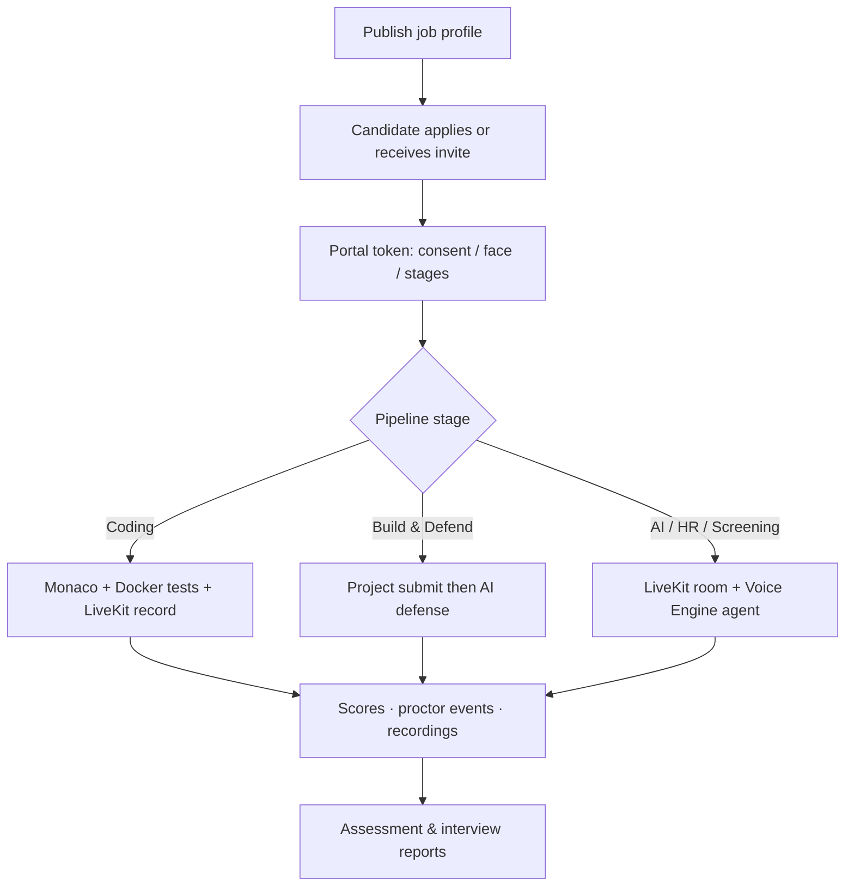
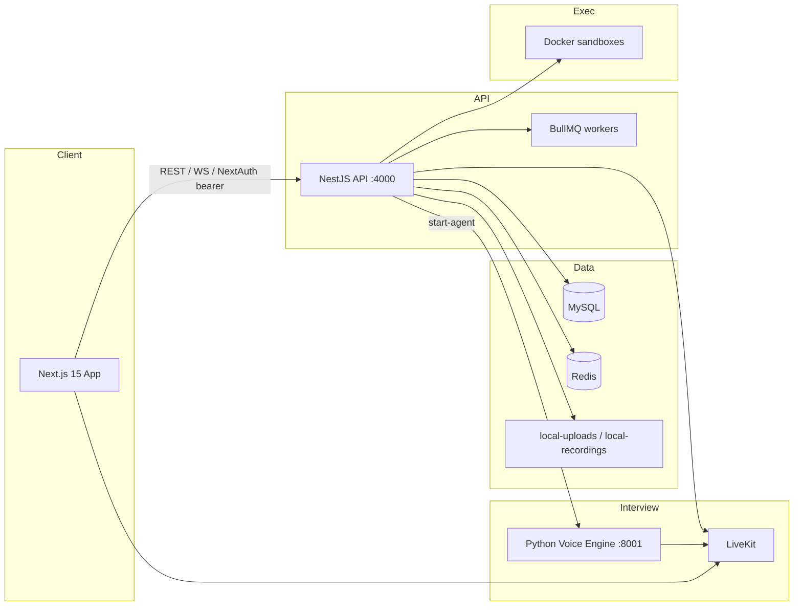

# CodeVox

**AI-powered technical hiring** — autonomous voice interviews, sandboxed coding assessments, and integrity-backed reports in one platform.

<p align="center">
  
</p>

<p align="center">
  <a href="#features">Features</a> ·
  <a href="#how-it-works">How it works</a> ·
  <a href="#project-structure">Structure</a> ·
  <a href="#tech-stack">Tech stack</a> ·
  <a href="#getting-started">Getting started</a>
</p>

---

## Overview

CodeVox is an end-to-end recruitment assessment platform for engineering hiring. Recruiters define multi-stage job pipelines; candidates complete coding rounds, Build & Defend projects, and AI voice interviews; the system scores, proctors, and produces shareable reports.

| Role | What you get |
|------|----------------|
| **Recruiters** | Job profiles, problem/question banks, lead inbox, live session monitor, assessment & interview reports |
| **Candidates** | Tokenized portal, Monaco IDE with Docker sandbox, LiveKit AI interviews, warmup & consent flows |
| **Ops** | Face/focus proctoring, plagiarism & AI-content checks, integrity overrides, PDF/Excel export |

---

## Screenshots

### Landing page

<p align="center">
  
</p>

### Candidate interview report

<p align="center">
  
</p>

### AI interview

<p align="center">
  
</p>

---

## Features

### Autonomous AI interviews
- Real-time conversational interviewer over **LiveKit WebRTC**
- Python **voice engine** with Sarvam STT/TTS and adaptive LLM follow-ups
- Phases: intro, AI verbal, HR verbal, AI soft screening, Build & Defend defense
- Live transcription, recordings under `local-recordings/`, shareable interview reports

### Sandboxed coding assessments
- Multi-language **Monaco** IDE (Python, JavaScript, SQL, PHP, and more)
- **Docker** runners for visible and private test cases
- Screen share / track recording via LiveKit during the attempt

### Job profiles & pipelines
- Configurable stages: screening, coding, take-home, project interview, AI/HR verbal, panel, custom
- LLM-assisted JD drafting, competencies, rubrics, and problem generation
- Public apply page at `/apply/[slug]` with resume upload/parse

### Recruitment operations
- Lead inbox, bulk invites, time slots, human interview checklist
- Queued resume screening and AI qualification signals
- Silent admin viewport to monitor live candidate A/V and transcripts

### Integrity & proctoring
- Client-side face presence / multi-face detection (`@vladmandic/face-api`)
- Focus, fullscreen, and media-strike policies (configurable)
- Plagiarism (Dolos) and AI-content detection (Deepflag) for submissions

### Analytics & reports
- Per-application stage scores, transcripts, and integrity status
- Overall evaluation with optional integrity override
- Frontend PDF / Excel export; share tokens for interview reports

---

## How it works

### End-to-end hiring flow



### System architecture



**Voice interview path**
1. Nest creates a LiveKit room and candidate token.
2. Nest calls `POST /api/v1/voice/start-agent` on the voice engine with job/phase context.
3. The agent joins the room (STT → LLM → TTS); the browser uses `livekit-client`.
4. Optional egress writes MP4s to `local-recordings/`.
5. Transcripts and scores callback to Nest via `NESTJS_CALLBACK_URL` + service key.

**Coding path**
1. Candidate opens `/candidate/coding/[token]`.
2. Nest runs submissions in Docker against test cases.
3. LiveKit captures screen/audio for ops review while proctor hooks log integrity events.

---

## Project structure

```
CodeVox/
├── codevox-frontend/                 # Next.js 15 (App Router) + React 19
│   ├── src/app/                      # Routes
│   │   ├── apply/[slug]/             # Public job application
│   │   ├── assessments/(admin)/      # Recruiter console (auth-gated)
│   │   ├── assessments/candidate/    # Candidate assessment / B&D
│   │   ├── autonomous-interview/     # AI voice interview room
│   │   ├── candidate/                # Portal, coding IDE, warmup, demo
│   │   ├── interview-report/         # Shareable interview report
│   │   └── signin/                   # Local credentials login
│   ├── src/modules/
│   │   ├── assessments/              # Admin IDE shell, assessment UI
│   │   ├── autonomous-interview/     # LiveKit room, proctor hooks
│   │   ├── job-profiles/             # Profile builder, banks, analytics
│   │   ├── recruitment/              # Leads, interviews, monitor, config
│   │   ├── assessment-reports/       # Application-level reports
│   │   ├── proctor/                  # Face / focus / liveness helpers
│   │   └── marketing/                # Landing page
│   └── public/                       # Face-API models, interview assets
│
├── codevox-backend/                  # NestJS 11 API
│   ├── src/
│   │   ├── auth/ · authorization/    # Local bearer + RBAC
│   │   ├── modules/
│   │   │   ├── job-profiles/         # Profiles, stages, portal, AI gen
│   │   │   ├── recruitment/          # Leads, invites, slots, resume screen
│   │   │   ├── autonomous-interview/ # Sessions, LiveKit, voice client
│   │   │   ├── coding-round/         # Timed coding attempt + submit
│   │   │   ├── project-interview/    # Build & Defend + LLM/Excel grade
│   │   │   ├── assessment-execution/ # Docker runners, plagiarism
│   │   │   ├── assessment-platform/  # Question engine & evaluation
│   │   │   ├── assessment-reports/   # Aggregated reports
│   │   │   ├── ai-detection/         # AI-written content analysis
│   │   │   ├── proctor/ · integrity/ # Integrity entities & helpers
│   │   │   ├── email/                # SMTP invites / reminders
│   │   │   └── system-config/        # Dashboard-tunable keys
│   │   ├── queue/                    # BullMQ (eval, plagiarism, resume)
│   │   └── files/                    # Local disk storage helpers
│   ├── services/voice-engine/        # FastAPI LiveKit voice agents
│   ├── sql/                          # Migrations + local RBAC bootstrap
│   ├── local-uploads/                # Uploaded files
│   └── local-recordings/             # Interview / coding recordings
│
├── docs/screenshots/                 # README product screenshots
├── LICENSE                           # MIT
└── README.md
```

### Key routes

| Area | Path |
|------|------|
| Landing | `/` |
| Admin login | `/signin` |
| Dashboard | `/assessments` |
| Job profiles | `/assessments/job-profiles` |
| Leads / interviews | `/assessments/recruitment/leads`, `…/interviews` |
| Live monitor | `/assessments/recruitment/monitor/[token]` |
| Reports | `/assessments/assessment-reports` |
| Public apply | `/apply/[slug]` |
| Candidate portal | `/candidate/portal/[token]` |
| Coding IDE | `/candidate/coding/[token]` |
| AI interview | `/autonomous-interview/[token]` |
| Shared report | `/interview-report/[shareToken]` |

---

## Tech stack

| Layer | Technologies |
|-------|----------------|
| **Frontend** | Next.js 15, React 19, Tailwind CSS, TanStack Query, Monaco, TipTap, LiveKit client, face-api, xterm, jsPDF, xlsx |
| **Backend** | NestJS 11, TypeORM, Passport (bearer), BullMQ, WebSockets, ExcelJS, Nodemailer |
| **Database** | MySQL |
| **Queues** | Redis + BullMQ |
| **Voice** | FastAPI, LiveKit Agents, Sarvam STT/TTS, Silero VAD |
| **Execution** | Docker sandboxes for code & SQL |
| **AI** | OpenAI-compatible APIs, Gemini (take-home), Cerebras, Sarvam LLM, Deepflag |
| **Auth** | NextAuth credentials ↔ `LOCAL_AUTH_TOKEN` bearer + MySQL RBAC |
| **Storage** | Local disk (`local-uploads/`, `local-recordings/`) |

---

## Getting started

### Prerequisites

- Node.js 20+
- MySQL 8+
- Docker Desktop (coding sandboxes; optional LiveKit stack)
- Redis (when queues are enabled)
- Python 3.11+ (voice engine, or run via Docker Compose)

### 1. Backend

```bash
cd codevox-backend
cp .env.example .env
# Fill MySQL, LOCAL_AUTH_*, LiveKit, VOICE_ENGINE_URL, LLM keys — see below
npm install
# Apply SQL under sql/local/ (e.g. 001_rbac_bootstrap.sql) and sql/migrations/
npm run dev
```

Health check: [http://localhost:4000/health](http://localhost:4000/health)

### 2. Frontend

```bash
cd codevox-frontend
cp .env.example .env.local
# Match LOCAL_AUTH_TOKEN with the backend; set NEXT_PUBLIC_RECRUITMENT_API_URL=http://localhost:4000
npm install
npm run dev
```

Open [http://localhost:3000](http://localhost:3000) and sign in with `admin@localhost` / `admin` (or your `LOCAL_AUTH_*` values).

### 3. Voice engine & LiveKit (AI interviews)

```bash
cd codevox-backend/services/voice-engine
# Option A — Docker stack (Redis + LiveKit + egress + voice engine)
docker compose up -d

# Option B — local Python
pip install -r requirements.txt
uvicorn main:app --host 0.0.0.0 --port 8001 --reload
```

Point Nest at the agent with `VOICE_ENGINE_URL=http://localhost:8001` and a shared `AUTONOMOUS_INTERVIEW_SERVICE_KEY`.

### Default ports

| Service | Port |
|---------|------|
| Frontend | `3000` |
| Nest API | `4000` |
| Voice engine | `8001` |
| LiveKit (compose) | `7885` (mapped), plus `7886` / `7887/udp` |
| Redis (compose) | `6379` |

---

## Configuration

Keep frontend and backend auth tokens in sync.

**Frontend** (`.env.local`) — see `codevox-frontend/.env.example`:

- `NEXTAUTH_URL`, `NEXTAUTH_SECRET`, `NEXT_PUBLIC_APP_URL`
- `NEXT_PUBLIC_RECRUITMENT_API_URL` → Nest base URL
- `LOCAL_AUTH_TOKEN`, `LOCAL_AUTH_EMAIL`, `LOCAL_AUTH_PASSWORD`
- `NEXT_PUBLIC_FACE`, `NEXT_PUBLIC_PROCTOR_*` strike policies

**Backend** (`.env`) — copy from `.env.example` and set at least:

- **MySQL:** `RECRUITMENT_MYSQL_HOST|PORT|USER|PASSWORD|DATABASE`
- **Auth:** `LOCAL_AUTH_TOKEN`, `LOCAL_AUTH_EMAIL`, `LOCAL_AUTH_NAME`, `LOCAL_AUTH_ADMNO`
- **App:** `PORT`, `CORS_ORIGIN`, `PUBLIC_API_BASE_URL`, `LOCAL_UPLOADS_DIR`
- **Redis:** `REDIS_URL`, `REDIS_ENABLED`
- **LiveKit:** `LIVEKIT_URL`, `LIVEKIT_PUBLIC_URL`, `LIVEKIT_API_KEY`, `LIVEKIT_API_SECRET`
- **Voice:** `VOICE_ENGINE_URL`, `AUTONOMOUS_INTERVIEW_SERVICE_KEY`, `NESTJS_CALLBACK_URL`, `SARVAM_API_KEY`
- **LLM:** `OPENAI_API_KEY`, `OPENAI_BASE_URL`, `OPENAI_MODEL` (plus optional take-home / Cerebras keys)
- **Optional:** `SMTP_*`, `DEEPFLAG_API_KEY`, `FACE`, `PROCTOR_*`, `RECORDING_MODE`

Admin API calls use `Authorization: Bearer <LOCAL_AUTH_TOKEN>`. Candidate portal, coding, interview join, and public apply routes are token-scoped and do not require the admin bearer.

---

## Auth model

- **Frontend:** NextAuth credentials provider (no Keycloak in this repo). Session JWT carries `LOCAL_AUTH_TOKEN` as the API access token.
- **Backend:** Custom bearer strategy validates that token and provisions/loads the local admin into shared `users` / `user_roles` / `permissions`.
- **Permissions:** `assessments:read|write`, `job_profiles:read|write` (and related approve/moderate keys where used). Seed via `codevox-backend/sql/local/001_rbac_bootstrap.sql`.

---

## Repository layout at a glance

| Package | Role |
|---------|------|
| [`codevox-frontend`](./codevox-frontend) | Recruiter console, candidate experiences, marketing site |
| [`codevox-backend`](./codevox-backend) | Nest API, queues, Docker execution, LiveKit orchestration |
| [`codevox-backend/services/voice-engine`](./codevox-backend/services/voice-engine) | FastAPI voice agents for autonomous interviews |

More detail: [backend README](./codevox-backend/README.md) · [voice-engine README](./codevox-backend/services/voice-engine/README.md)

---

## License

This project is licensed under the [MIT License](./LICENSE) — Copyright © 2026 Akshat Desai.
