# CodeVox

**AI-powered technical hiring** — autonomous voice interviews, sandboxed coding assessments, and integrity-backed reports in one platform.

<p align="center">
  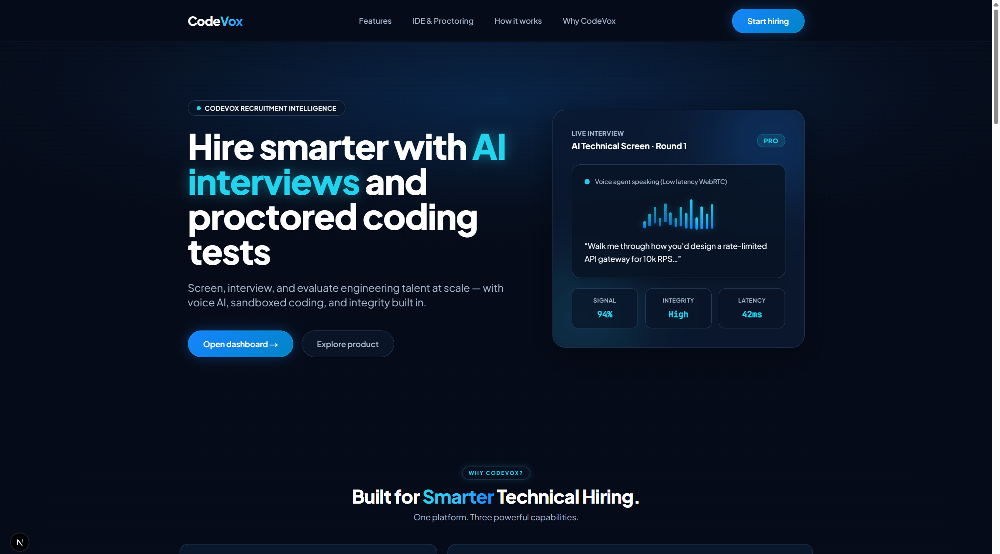
</p>

<p align="center">
  <a href="#screenshots">Screenshots</a> ·
  <a href="#features">Features</a> ·
  <a href="#how-it-works">How it works</a> ·
  <a href="#project-structure">Structure</a> ·
  <a href="#getting-started">Getting started</a>
</p>

---

## Overview

CodeVox is an end-to-end recruitment assessment platform for engineering hiring. Recruiters design job pipelines and problem banks; candidates complete system-readiness checks, timed coding rounds, and LiveKit AI voice interviews; ops monitor live sessions and review stage-level reports.

| Role | What you get |
|------|----------------|
| **Recruiters** | Job profiles, AI problem architect, lead inbox, live coding monitor, assessment reports |
| **Candidates** | Portal roadmap, camera/mic/network checks, Monaco coding IDE, AI verbal interview room |
| **Ops** | Screen-share proctoring, strike policies, integrity signals, AI evaluation synthesis |

---

## Screenshots

### Landing

Product marketing surface — AI interviews, proctored coding, and hiring signal at a glance.

<p align="center">
  
</p>

### Recruiter — AI problem bank

Create coding / SQL problems manually or generate them with the **Coding Problem Architect** (difficulty, seniority, presets).

<p align="center">
  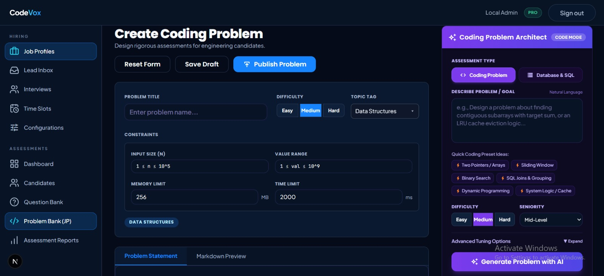
</p>

### Candidate — portal & readiness

Welcome portal with language preference, assessment roadmap, then **System readiness** (camera, mic, network) before entering a round.

<p align="center">
  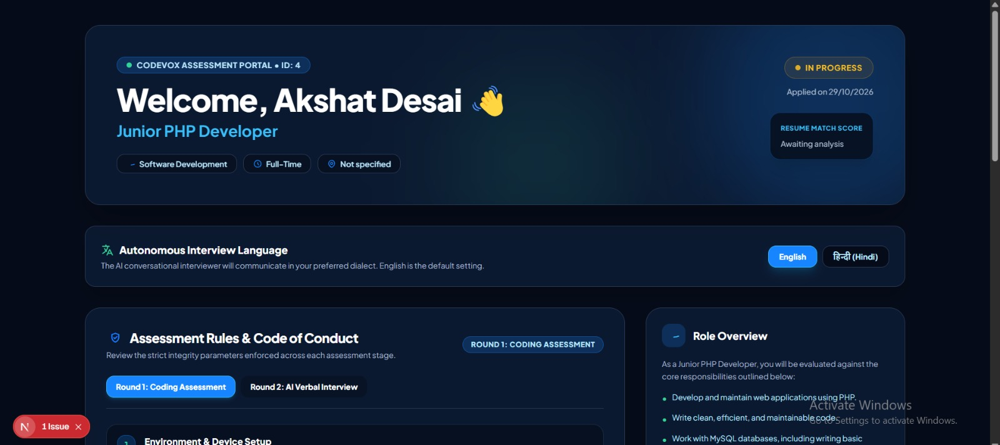
</p>

<p align="center">
  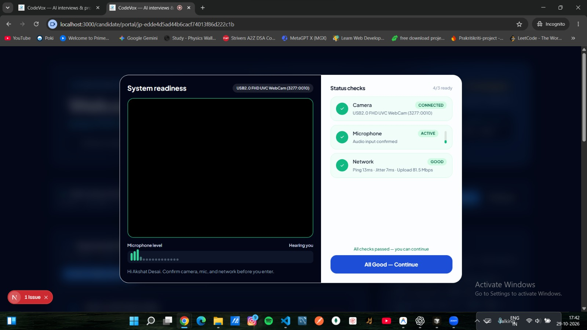
</p>

### Candidate — application stages

Sequential stages (e.g. coding → unified AI voice interview) with estimated time and proctoring flags.

<p align="center">
  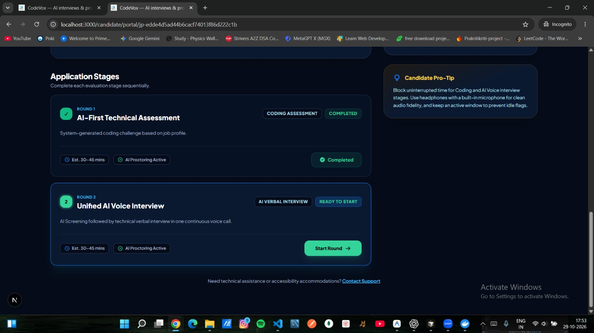
</p>

### Candidate — coding assessment

Timed Monaco IDE with problem statement, test cases, run/submit, and live screen recording (`REC`).

<p align="center">
  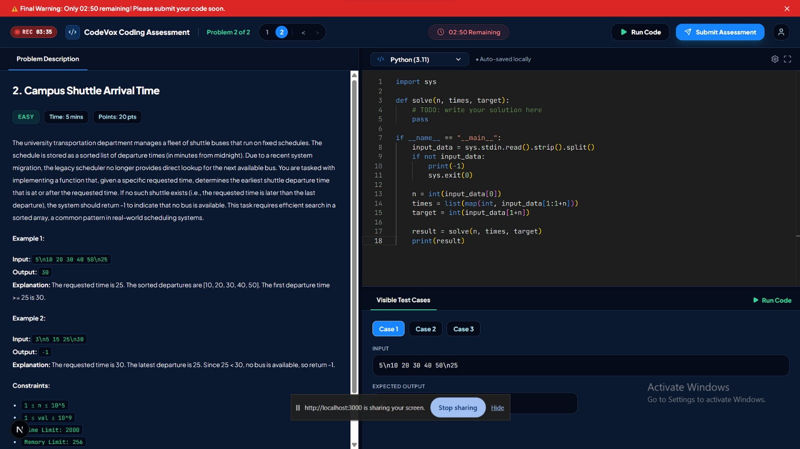
</p>

### Ops — live coding monitor

Silent admin viewport over the candidate screen share, with strikes, gaze hint, dual/screen/camera layout, and flag-moment.

<p align="center">
  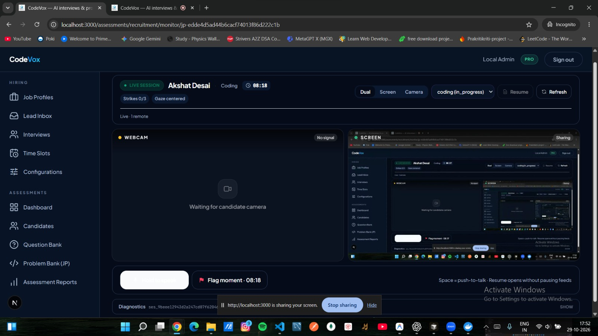
</p>

### Candidate — AI verbal interview

LiveKit voice room: AI interviewer speaking, mic/cam/screen controls, assessment engine panel, realtime dialogue sync.

<p align="center">
  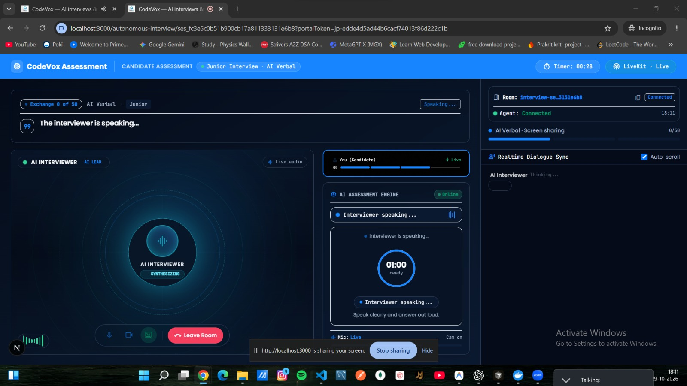
</p>

### Candidate — assessment complete

Thank-you state after the candidate finishes the assessment flow.

<p align="center">
  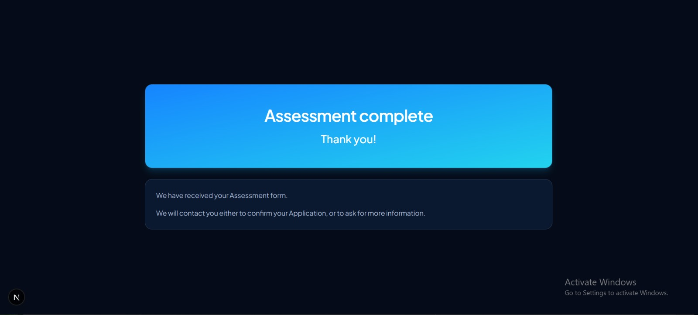
</p>

### Recruiter — assessment report

Per-application round breakdown (coding scores, languages, test-case pass rates) plus AI evaluation synthesis.

<p align="center">
  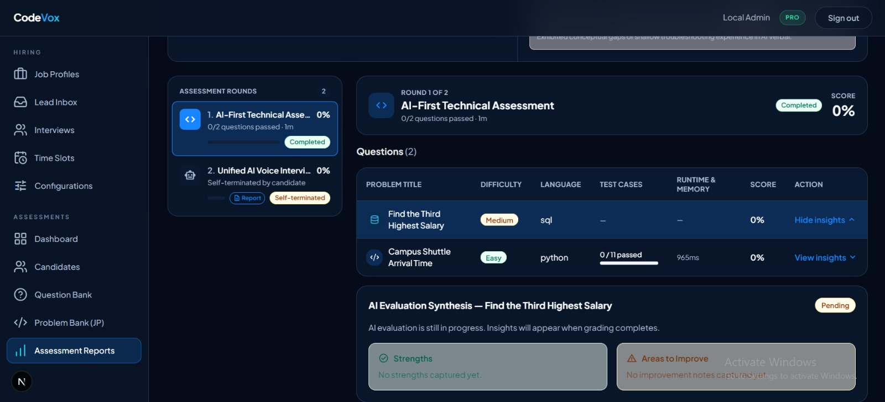
</p>

Overall hire evaluation for a completed demo candidate (rounds score, recommendation, why hire / why not).

<p align="center">
  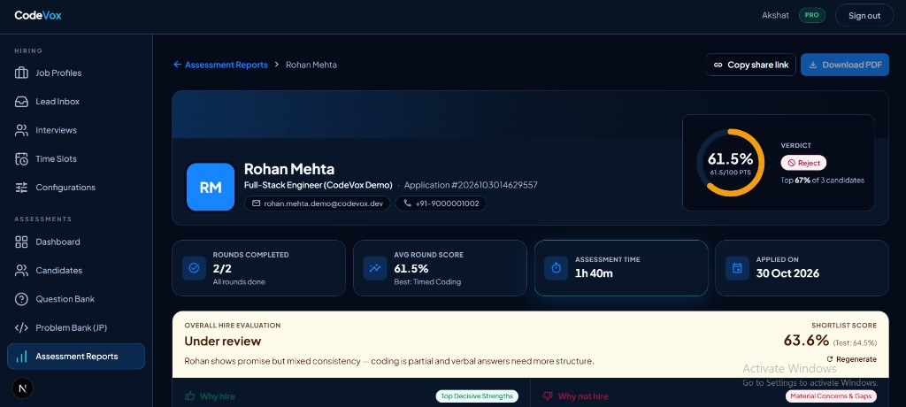
</p>

---

## Features

### Autonomous AI interviews
- Real-time conversational interviewer over **LiveKit WebRTC**
- Python **voice engine** (Sarvam STT/TTS + adaptive LLM follow-ups)
- Phases: screening, AI verbal, HR verbal, Build & Defend defense
- Live dialogue sync, recordings, and shareable interview reports

### Sandboxed coding assessments
- Multi-language **Monaco** IDE (Python, SQL, JavaScript, PHP, and more)
- Visible / private test cases via **Docker** runners
- Timed attempts with screen share + track recording for ops review

### Job profiles & problem banks
- Configurable pipeline stages (coding, AI verbal, take-home, project interview, …)
- Manual authoring plus **AI Coding Problem Architect** generation
- Public apply URL and resume parse into the candidate portal

### Recruitment operations
- Lead inbox, invites, time slots, human interview tooling
- Live monitor for coding / interview rooms (dual · screen · camera)
- System Configurations dashboard for FACE / proctor strike policies

### Integrity & reports
- Focus / media strikes, fullscreen and tab-away policies
- Stage snapshots, AI evaluation synthesis, PDF / Excel export

---

## How it works

### End-to-end hiring flow

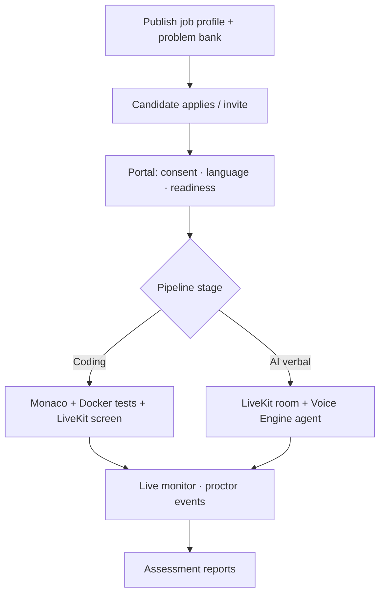

### System architecture

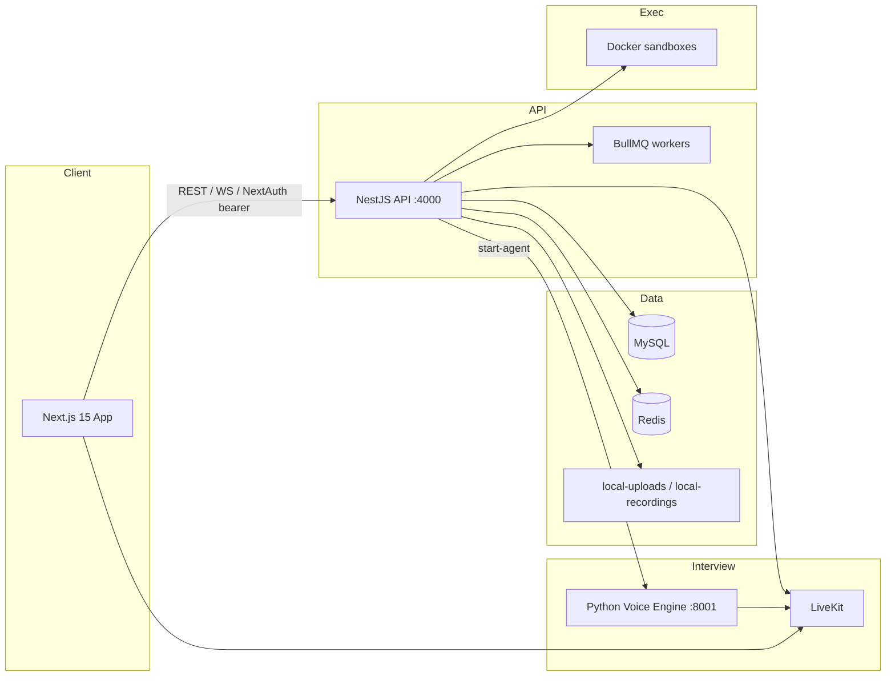

**Coding path** — portal → system readiness → `/candidate/coding/[token]` → Docker run/submit → LiveKit screen share for monitor & recording.

**Voice path** — Nest mints LiveKit room → voice-engine `start-agent` → browser `livekit-client` → transcripts/scores callback to Nest.

---

## Project structure

```
CodeVox/
├── codevox-frontend/                 # Next.js 15 (App Router) + React 19
│   ├── src/app/                      # Routes (apply, assessments, candidate, interview)
│   ├── src/modules/                  # Feature modules (job-profiles, recruitment, AI interview, …)
│   └── public/                       # Face-API models, brand assets
│
├── codevox-backend/                  # NestJS 11 API
│   ├── src/modules/                  # coding-round, autonomous-interview, reports, …
│   ├── services/voice-engine/        # FastAPI LiveKit voice agents
│   ├── sql/                          # Migrations + local RBAC bootstrap
│   ├── local-uploads/ · local-recordings/
│
├── docs/screenshots/                 # README product screenshots
├── LICENSE
└── README.md
```

### Key routes

| Area | Path |
|------|------|
| Landing | `/` |
| Admin | `/signin` → `/assessments` |
| Problem bank | `/assessments/job-profiles/problem-bank` |
| Live monitor | `/assessments/recruitment/monitor/[token]` |
| Assessment reports | `/assessments/assessment-reports` |
| Candidate portal | `/candidate/portal/[token]` |
| Coding IDE | `/candidate/coding/[token]` |
| AI interview | `/autonomous-interview/[token]` |

---

## Tech stack

| Layer | Technologies |
|-------|----------------|
| **Frontend** | Next.js 15, React 19, Tailwind, TanStack Query, Monaco, TipTap, LiveKit client, face-api |
| **Backend** | NestJS 11, TypeORM, Passport bearer, BullMQ, WebSockets |
| **Database** | MySQL |
| **Queues** | Redis + BullMQ |
| **Voice** | FastAPI, LiveKit Agents, Sarvam STT/TTS |
| **Execution** | Docker sandboxes |
| **AI** | OpenAI-compatible APIs, Gemini (take-home / problem gen), Sarvam LLM |
| **Auth** | NextAuth credentials ↔ `LOCAL_AUTH_TOKEN` + MySQL RBAC |
| **Storage** | Local disk (`local-uploads/`, `local-recordings/`) |

---

## Getting started

### Prerequisites

- Node.js 20+
- MySQL 8+
- Docker Desktop (coding sandboxes + LiveKit stack)
- Redis (when queues are enabled)

### 1. Backend

```bash
cd codevox-backend
cp .env.example .env
npm install
# Apply sql/local/001_rbac_bootstrap.sql and migrations
npm run dev
```

Health: [http://localhost:4000/health](http://localhost:4000/health)

### 2. Frontend

```bash
cd codevox-frontend
cp .env.example .env.local
npm install
npm run dev
```

Open [http://localhost:3000](http://localhost:3000) — **Live demo →** auto-signs in as `akshat@CodeVox` / `admin` (or your `LOCAL_AUTH_*` values).

### Production (Docker / Oracle free tier)

```bash
cp .env.prod.example .env.prod   # fill secrets
docker compose -f docker-compose.prod.yml --env-file .env.prod up -d --build
```

Recordings stay off by default. Optional LiveKit egress: add `--profile recording`.

### 3. LiveKit / voice engine

```bash
cd codevox-backend/services/voice-engine
docker compose up -d
```

| Service | Port |
|---------|------|
| Frontend | `3000` |
| Nest API | `4000` |
| Voice engine | `8001` |
| LiveKit | `7885` (+ `7886`, `7887/udp`) |
| Redis | `6379` |

---

## Configuration

Keep frontend and backend `LOCAL_AUTH_TOKEN` in sync. Proctor / FACE knobs can be set in `.env` or overridden from **System Configurations** in the admin UI (they apply to coding rounds and interviews).

**Frontend** — `NEXTAUTH_*`, `NEXT_PUBLIC_RECRUITMENT_API_URL`, `LOCAL_AUTH_*`, `NEXT_PUBLIC_FACE`, `NEXT_PUBLIC_PROCTOR_*`

**Backend** — MySQL `RECRUITMENT_MYSQL_*`, `LOCAL_AUTH_*`, LiveKit, `VOICE_ENGINE_URL`, LLM keys, `PROCTOR_*`, `FACE`

---

## Auth

- **Frontend:** NextAuth credentials → JWT carries `LOCAL_AUTH_TOKEN`
- **Backend:** Bearer `LOCAL_AUTH_TOKEN` + RBAC (`assessments:*`, `job_profiles:*`)
- Candidate portal / coding / interview join routes are token-scoped (no admin bearer)

---

## License

[MIT](./LICENSE) — Copyright © 2026 Akshat Desai.
